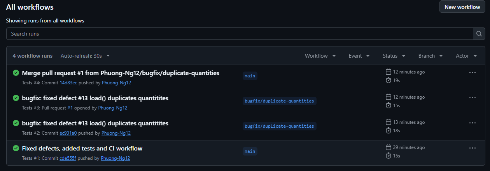
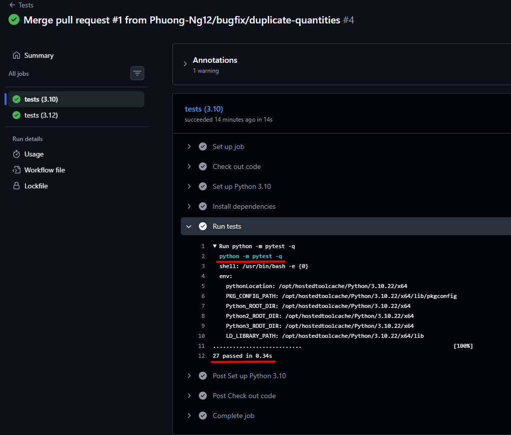

# Order-processing system — student starter

This application intentionally contains defects. Your assignment has three parts only:

1. Identify and correct at least 8 meaningful defects.
2. Write at least 12 automated unit tests with `pytest`.
3. Add `.github/workflows/tests.yml` to run tests on pushes and pull requests.

## Application files

- `models.py`: domain objects
- `cart.py`: shopping cart and discounts
- `repository.py`: SQLite products, saved carts, inventory and orders
- `checkout.py`: checkout workflow
- `payments.py`: simulated payment gateway
- `setup_db.py` and `demo.py`: demo database and execution
- `tests/test_smoke.py`: minimal smoke tests (not a solution)

## Running locally

```bash
python -m pip install -r requirements.txt
python -m pytest -q
python setup_db.py
python demo.py
```

Use temporary databases and fake payment tokens for unit tests. No real payment credentials are required.

# Successful GitHub Actions run

Tests run automatically with GitHub Actions on every push and pull request (`.github/workflows/tests.yml`).

### Workflow runs (push and pull request triggers)


### Test output from a run
